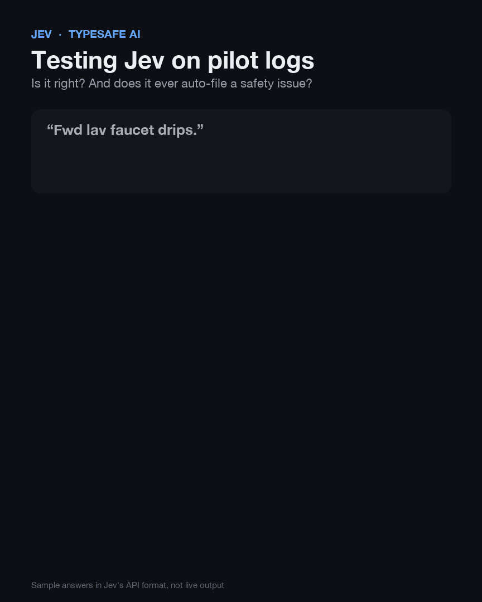

# Flight logs: non-generative decisions with Jev

Pilots write free-text defects in the aircraft tech log after every flight. Maintenance has to decide quickly what each one means: which system it affects, and whether it's a safety issue.

This repo tests [Jev](https://docs.typesafe.ai/introduction), TypeSafe AI's "System One" model, on that job. Jev doesn't generate text. It returns typed answers with calibrated probabilities, and plain code makes the decision.



## What the test does

1. Asks Jev two questions about each write-up in a single call:
   - `system` (choice): cabin, hydraulics, landing gear or air conditioning.
   - `affects_safety` (noul): the probability that the defect could affect safe flight.
2. Routes each write-up with three rules:
   - Confidence below 0.80: send it to an **engineer**.
   - Safety risk above 0.50: raise an **alert**.
   - Otherwise: **auto-file** it as cosmetic.
3. Checks Jev's answers against what an engineer would say, and **fails if a safety item would ever be filed automatically**.

## Run it

Python 3 standard library only, nothing to install.

```bash
# Offline, using sample answers (not real Jev output)
python3 flight_log_test.py

# Live, against Jev
TYPESAFE_API_KEY=your_key python3 flight_log_test.py
```

Offline output:

```
✓ Fwd lav faucet drips.                cabin             conf 0.97  safety 0.03  → AUTO-FILE (cosmetic)
✓ Hyd sys B qty fluctuating.           hydraulics        conf 0.95  safety 0.91  → ALERT     (possible safety issue)
✓ #2 main tyre worn to limit.          landing_gear      conf 0.99  safety 0.88  → ALERT     (possible safety issue)
✓ Burning smell aft cabin in climb.    air_conditioning  conf 0.44  safety 0.79  → ENGINEER  (Jev is unsure)

4/4 systems correct · no safety item was auto-filed · sample answers
```

## Notes

- The offline answers and the numbers in the GIF are illustrative, written in Jev's documented response format. Run with a key to see what the model really returns.
- Four write-ups is a smoke test, not an evaluation. To judge accuracy and calibration properly, use a few hundred write-ups labelled by engineers.
- This is a demo, not maintenance software. Airworthiness decisions belong to licensed engineers.
